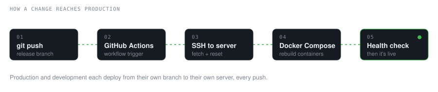

<picture>
  <source media="(prefers-color-scheme: dark)" srcset="assets/terminal-dark.svg">
  <source media="(prefers-color-scheme: light)" srcset="assets/terminal-light.svg">
  
</picture>

 

Hi, I'm Tonmoy. I look after the systems at **[Loop Freight](https://loopfreight.io)**, a logistics company in Dhaka.

Most of my day is keeping things running: the servers, the containers, the database, the network, and the pipeline that ships every change. When something breaks at 2 AM, it usually ends up with me. I also build and maintain the apps our ops team, field agents and finance people use to move trucks around the country.

 

<picture>
  <source media="(prefers-color-scheme: dark)" srcset="assets/pipeline-dark.svg">
  <source media="(prefers-color-scheme: light)" srcset="assets/pipeline-light.svg">
  
</picture>

 

#### What I've been working on

- Moving our deploys onto GitHub Actions, with separate production and development servers
- Setting up the office network so several servers can sit behind one router
- PostgreSQL work: indexes, slow queries, triggers that log changes made by outside apps
- Real-time notifications between two apps that share one database, using `LISTEN/NOTIFY`
- Cutting frontend build and load times by moving off Create React App to Vite

#### Tools I use most

`Linux` `Docker` `Docker Compose` `Nginx` `GitHub Actions` `Cloudflare` `PostgreSQL` `Node.js` `Express` `React` `Bash` `Git`

#### Get in touch

[LinkedIn](https://www.linkedin.com/in/tonmoysarker2208/) · [Email](mailto:tonmoysarker2208@gmail.com)
